# PRAKTIKUM JARKOM MODUL 4 KELOMPOK [ISI NOMOR KELOMPOK] - 2026

**Serial Experiments Lain - Layer:04 - The Wired Expansion**

## Anggota Kelompok

| Nama | NRP |
| ---- | --- |
| Arjunina Maqbulin Usman | 5027251007 |
| M. Rama Maulana Wafa | 5027251019 |

## Laporan

LINK SPREADSHEET:                             
https://docs.google.com/spreadsheets/d/1D2sDWEG0VZ9-sXc3dvDwEGPmrPENuvI2/edit?gid=1554854904#gid=1554854904

## Ringkasan Soal

Lain membangun ulang The Wired dalam skala besar. Hanya klub Cyberia yang terhubung ke dunia nyata melalui Cloud (CPT) / NAT (GNS3). Dari Cyberia, seluruh lalu lintas mengalir ke Wired, sebuah hub yang bercabang ke Navi, Tachibana, dan satu segmen bersama milik Psyche, Copland, dan Schumann. Tugasnya adalah membagi alamat IP dan menyusun routing seefisien mungkin, sehingga tidak ada alamat yang terbuang dan tidak ada entitas yang terisolasi.

Prefix IP kelompok: **10.91.0.0**

---

## CPT - CIDR

### 1. Topologi dan Analisa Subnet

Berikut topologi yang dibuat untuk Cisco Packet Tracer.

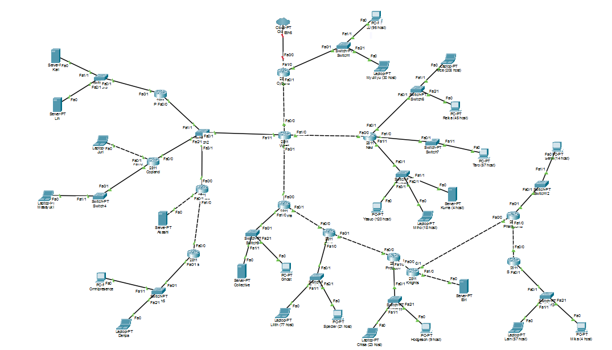

Topologi terdiri dari 13 router (Cyberia, Wired, Psyche, Copland, Schumann, Accela, Navi, Tachibana, Deus, Protocol7, Knights, Phantoma, Shibuya), 13 switch, dan beberapa client. Setelah dianalisa, terdapat **25 subnet** dengan aturan berikut:

- Satu switch dihitung sebagai satu subnet. Jumlah IP = total host semua client pada switch itu + 1 interface router (gateway).
- Client yang terhubung langsung ke router (Juri, Akashi, Eiri) membentuk subnet sendiri, jumlah IP = host + 1 gateway.
- Link antar router adalah subnet dengan 2 IP (/30).
- Segmen Switch2 yang dipakai bersama Wired, Psyche, Copland, dan Schumann adalah satu subnet dengan 4 interface router.
- Link Cyberia ke Cloud tidak dihitung sebagai subnet.

Hasil labelling subnet beserta kebutuhan dan prefix-nya:                              
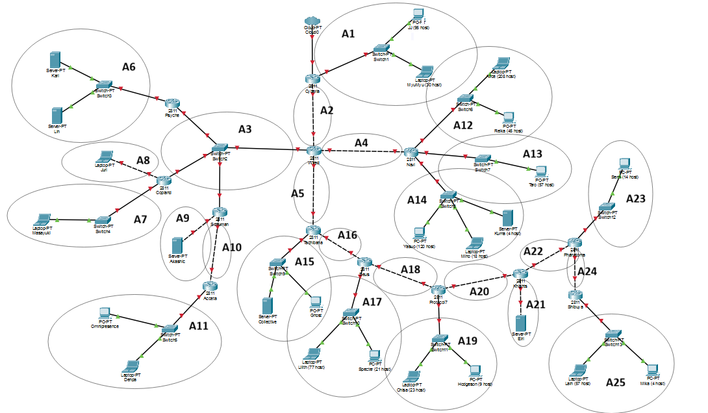
| Subnet | Segmen | Perhitungan | Jumlah IP | Prefix |
| ------ | ------ | ----------- | --------- | ------ |
| A1 | Switch1 (Cyberia): JJ, MyuMyu | 95 + 30 + 1 | 126 | /25 |
| A2 | Link Cyberia - Wired | 2 router | 2 | /30 |
| A3 | Switch2 (Wired, Psyche, Copland, Schumann) | 4 router | 4 | /29 |
| A4 | Link Wired - Navi | 2 router | 2 | /30 |
| A5 | Link Wired - Tachibana | 2 router | 2 | /30 |
| A6 | Switch3 (Psyche): Karl, Lin | 700 + 180 + 1 | 881 | /22 |
| A7 | Switch4 (Copland): Masayuki | 300 + 1 | 301 | /23 |
| A8 | Link Copland - Juri | 31 + 1 | 32 | /26 |
| A9 | Link Schumann - Akashi | 3 + 1 | 4 | /29 |
| A10 | Link Schumann - Accela | 2 router | 2 | /30 |
| A11 | Switch5 (Accela): Omnipresence, Denpa | 510 + 3 + 1 | 514 | /22 |
| A12 | Switch6 (Navi): Alice, Reika | 208 + 45 + 1 | 254 | /24 |
| A13 | Switch7 (Navi): Taro | 57 + 1 | 58 | /26 |
| A14 | Switch8 (Navi): Yasuo, Miho, Kuma | 120 + 18 + 4 + 1 | 143 | /24 |
| A15 | Switch9 (Tachibana): Collective, Ghost | 260 + 6 + 1 | 267 | /23 |
| A16 | Link Tachibana - Deus | 2 router | 2 | /30 |
| A17 | Switch10 (Deus): Lilith, Specter | 77 + 21 + 1 | 99 | /25 |
| A18 | Link Deus - Protocol7 | 2 router | 2 | /30 |
| A19 | Switch11 (Protocol7): Chisa, Hodgeson | 23 + 9 + 1 | 33 | /26 |
| A20 | Link Protocol7 - Knights | 2 router | 2 | /30 |
| A21 | Link Knights - Eiri | 2 + 1 | 3 | /29 |
| A22 | Link Knights - Phantoma | 2 router | 2 | /30 |
| A23 | Switch12 (Phantoma): Semi | 14 + 1 | 15 | /27 |
| A24 | Link Phantoma - Shibuya | 2 router | 2 | /30 |
| A25 | Switch13 (Shibuya): Lain, Mika | 57 + 4 + 1 | 62 | /26 |

Beberapa subnet berada tepat di batas kapasitas prefix-nya (A1 = 126 dari 126, A12 = 254 dari 254, A25 = 62 dari 62), dan A23 membutuhkan 15 IP sehingga melewati batas /28 (14 host) dan harus memakai /27.

### 2. Total Penggunaan Subnet

- Jumlah subnet: **25 subnet**.
- Total kebutuhan IP (host + gateway): **2814 IP**.
- Total alamat setelah tiap subnet dibulatkan ke ukuran blok (pangkat dua): **4188 alamat**.
- Karena 4188 lebih besar dari 4096 (/20), blok terkecil yang dapat menampung seluruh topologi adalah **/19** (8192 alamat). Blok akar yang dipakai: **10.91.0.0/19**.

### 3. Metode CIDR: Penggabungan Subnet

Pada metode CIDR, subnet digabung dari yang paling jauh dari internet (Cloud) menuju Cyberia, dua demi dua, sampai seluruh topologi menjadi satu blok besar. Aturan netmask hasil gabungan:

Hasil penggabungan seluruh level:

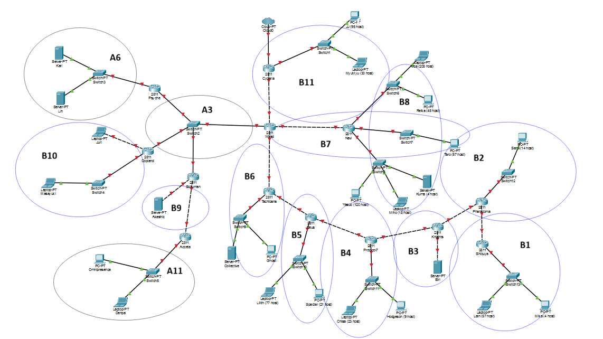
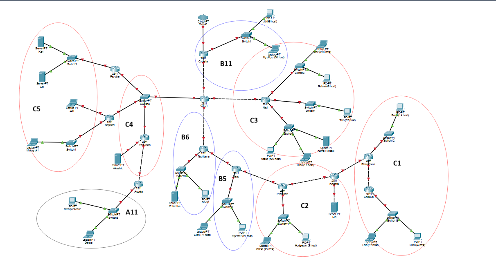
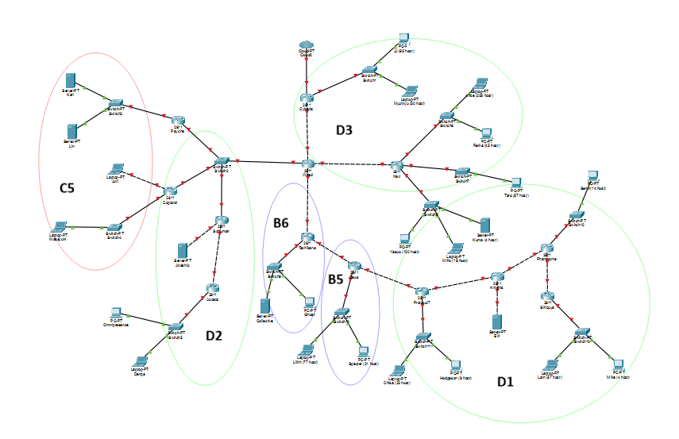
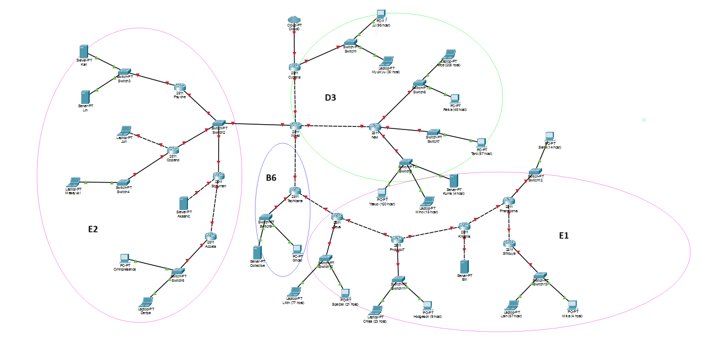
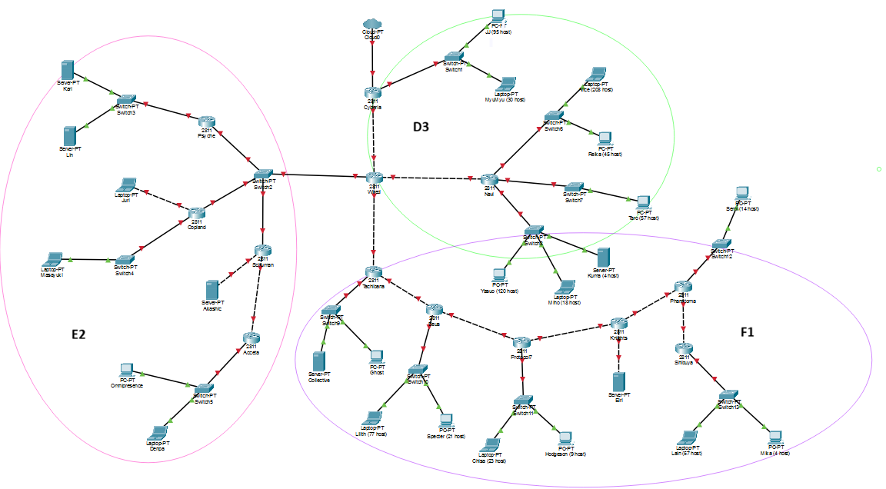
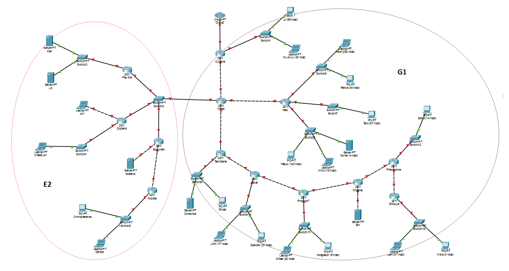
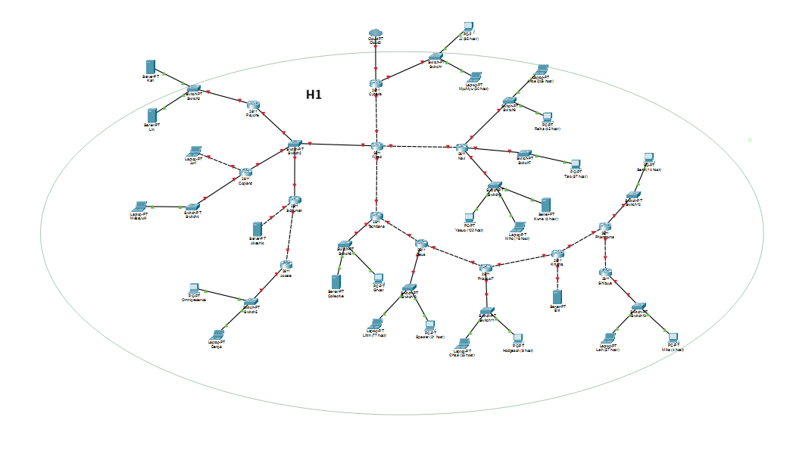

| Subnet | Gabungan dari 1 | Netmask | Gabungan dari 2 | Netmask | Netmask Akhir |
| ------ | --------------- | ------- | --------------- | ------- | ------------- |
| B1 | A25 | /26 | A24 | /30 | /25 |
| B2 | A23 | /27 | A22 | /30 | /26 |
| B3 | A21 | /29 | A20 | /30 | /28 |
| B4 | A19 | /26 | A18 | /30 | /25 |
| B5 | A17 | /25 | A16 | /30 | /24 |
| B6 | A15 | /23 | A5 | /30 | /22 |
| B7 | A13 | /26 | A4 | /30 | /25 |
| B8 | A12 | /24 | A14 | /24 | /23 |
| B9 | A9 | /29 | A10 | /30 | /28 |
| B10 | A7 | /23 | A8 | /26 | /22 |
| B11 | A1 | /25 | A2 | /30 | /24 |
| C1 | B1 | /25 | B2 | /26 | /24 |
| C2 | B3 | /28 | B4 | /25 | /24 |
| C3 | B7 | /25 | B8 | /23 | /22 |
| C4 | B9 | /28 | A3 | /29 | /27 |
| C5 | B10 | /22 | A6 | /22 | /21 |
| D1 | C1 | /24 | C2 | /24 | /23 |
| D2 | C4 | /27 | A11 | /22 | /21 |
| D3 | C3 | /22 | B11 | /24 | /21 |
| E1 | D1 | /23 | B5 | /24 | /22 |
| E2 | C5 | /21 | D2 | /21 | /20 |
| F1 | E1 | /22 | B6 | /22 | /21 |
| G1 | F1 | /21 | D3 | /21 | /20 |
| H1 | G1 | /20 | E2 | /20 | /19 |

Hasil akhir penggabungan menghasilkan tiga cabang utama dari router Wired, ditambah Cyberia:

| Cabang | Blok | Isi |
| ------ | ---- | --- |
| Selatan (Tachibana ke Shibuya) | F1 = 10.91.0.0/21 | Tachibana, Deus, Protocol7, Knights, Phantoma, Shibuya |
| Timur (Navi) | C3 = 10.91.8.0/22 | Navi dan tiga LAN-nya |
| Cyberia | B11 = 10.91.12.0/24 | LAN Switch1 dan link Cyberia - Wired |
| Barat (segmen Switch2) | E2 = 10.91.16.0/20 | Psyche, Copland, Schumann, Accela |

### 4. Pohon Pembagian IP

Blok akar `10.91.0.0/19` dibelah mengikuti urutan penggabungan (bukan dibelah rata seperti VLSM). Subnet yang lebih besar ditempatkan di alamat yang lebih rendah supaya awal blok selalu kelipatan ukurannya.

Angka seperti `0.64/30` berarti `10.91.0.64/30`.

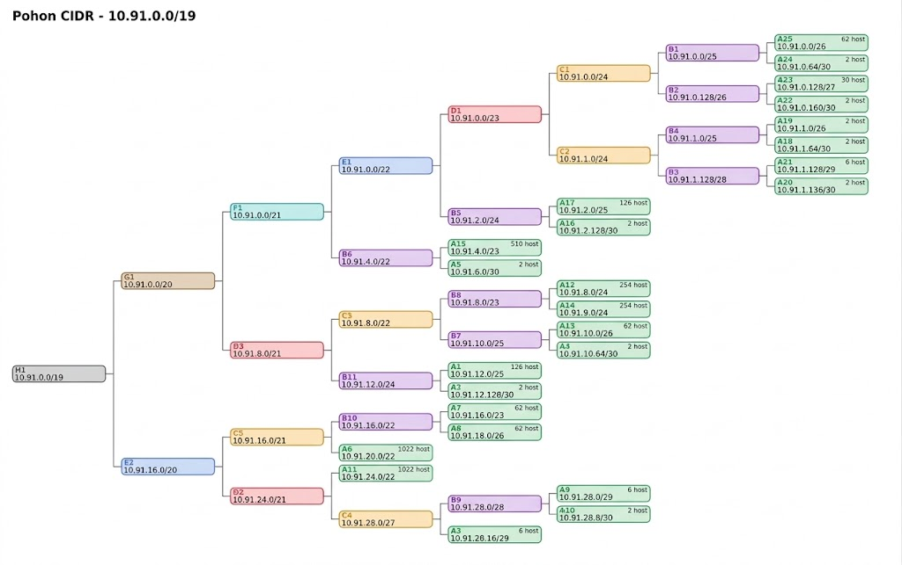 

### 5. Hasil Pembagian IP

| Subnet | Network ID | Netmask | Broadcast | Range IP |
| ------ | ---------- | ------- | --------- | -------- |
| A1 | 10.91.12.0 | 255.255.255.128 | 10.91.12.127 | 10.91.12.1 - 10.91.12.126 |
| A2 | 10.91.12.128 | 255.255.255.252 | 10.91.12.131 | 10.91.12.129 - 10.91.12.130 |
| A3 | 10.91.28.16 | 255.255.255.248 | 10.91.28.23 | 10.91.28.17 - 10.91.28.22 |
| A4 | 10.91.10.64 | 255.255.255.252 | 10.91.10.67 | 10.91.10.65 - 10.91.10.66 |
| A5 | 10.91.6.0 | 255.255.255.252 | 10.91.6.3 | 10.91.6.1 - 10.91.6.2 |
| A6 | 10.91.20.0 | 255.255.252.0 | 10.91.23.255 | 10.91.20.1 - 10.91.23.254 |
| A7 | 10.91.16.0 | 255.255.254.0 | 10.91.17.255 | 10.91.16.1 - 10.91.17.254 |
| A8 | 10.91.18.0 | 255.255.255.192 | 10.91.18.63 | 10.91.18.1 - 10.91.18.62 |
| A9 | 10.91.28.0 | 255.255.255.248 | 10.91.28.7 | 10.91.28.1 - 10.91.28.6 |
| A10 | 10.91.28.8 | 255.255.255.252 | 10.91.28.11 | 10.91.28.9 - 10.91.28.10 |
| A11 | 10.91.24.0 | 255.255.252.0 | 10.91.27.255 | 10.91.24.1 - 10.91.27.254 |
| A12 | 10.91.8.0 | 255.255.255.0 | 10.91.8.255 | 10.91.8.1 - 10.91.8.254 |
| A13 | 10.91.10.0 | 255.255.255.192 | 10.91.10.63 | 10.91.10.1 - 10.91.10.62 |
| A14 | 10.91.9.0 | 255.255.255.0 | 10.91.9.255 | 10.91.9.1 - 10.91.9.254 |
| A15 | 10.91.4.0 | 255.255.254.0 | 10.91.5.255 | 10.91.4.1 - 10.91.5.254 |
| A16 | 10.91.2.128 | 255.255.255.252 | 10.91.2.131 | 10.91.2.129 - 10.91.2.130 |
| A17 | 10.91.2.0 | 255.255.255.128 | 10.91.2.127 | 10.91.2.1 - 10.91.2.126 |
| A18 | 10.91.1.64 | 255.255.255.252 | 10.91.1.67 | 10.91.1.65 - 10.91.1.66 |
| A19 | 10.91.1.0 | 255.255.255.192 | 10.91.1.63 | 10.91.1.1 - 10.91.1.62 |
| A20 | 10.91.1.136 | 255.255.255.252 | 10.91.1.139 | 10.91.1.137 - 10.91.1.138 |
| A21 | 10.91.1.128 | 255.255.255.248 | 10.91.1.135 | 10.91.1.129 - 10.91.1.134 |
| A22 | 10.91.0.160 | 255.255.255.252 | 10.91.0.163 | 10.91.0.161 - 10.91.0.162 |
| A23 | 10.91.0.128 | 255.255.255.224 | 10.91.0.159 | 10.91.0.129 - 10.91.0.158 |
| A24 | 10.91.0.64 | 255.255.255.252 | 10.91.0.67 | 10.91.0.65 - 10.91.0.66 |
| A25 | 10.91.0.0 | 255.255.255.192 | 10.91.0.63 | 10.91.0.1 - 10.91.0.62 |

#### Studi Kasus Perhitungan: Subnet A6

Berikut langkah mendapatkan Prefix, Network ID, Broadcast, dan Range IP untuk **Subnet A6** (LAN Switch3 di Psyche).

**a. Menentukan Prefix (CIDR)**

- Kebutuhan: Karl (700 host) + Lin (180 host) + 1 gateway = 881 IP.
- Rumus: 2^n - 2 >= kebutuhan.
- 2^9 = 512 (kurang), 2^10 = 1024 (cukup), maka n = 10.
- Prefix = 32 - 10 = **/22** (netmask 255.255.252.0).

**b. Menghitung Block Size**

- Block size = 2^(32 - 22) = 2^10 = **1024** IP.
- 1024 / 256 = 4, sehingga subnet ini memakan 4 angka pada oktet ketiga.

**c. Menentukan Network ID dan Broadcast**

- Pada pohon, A6 adalah anak kedua dari C5 (10.91.16.0/21) sehingga NID-nya di **10.91.20.0**, tepat setelah B10 (10.91.16.0/22). Awal blok 20 adalah kelipatan 4, jadi valid.
- Next network = 20 + 4 = 24, yaitu 10.91.24.0.
- Broadcast = satu alamat sebelum next network = **10.91.23.255**.

**d. Menentukan Range IP**

- IP pertama = NID + 1 = **10.91.20.1** (dipakai sebagai gateway di router Psyche).
- IP terakhir = Broadcast - 1 = **10.91.23.254**.

### 6. Konfigurasi IP Interface Router

IP interface diisi pada tab Config di tiap router (menu INTERFACE, Port Status On, lalu isi IPv4 Address dan Subnet Mask). Port Cyberia ke Cloud tidak diisi.

| Router | Port | Terhubung ke | IPv4 Address | Subnet Mask |
| ------ | ---- | ------------ | ------------ | ----------- |
| Cyberia | Fa1/0 | Switch1 | 10.91.12.1 | 255.255.255.128 |
| Cyberia | Fa0/1 | Wired | 10.91.12.129 | 255.255.255.252 |
| Wired | Fa0/0 | Cyberia | 10.91.12.130 | 255.255.255.252 |
| Wired | Fa1/1 | Switch2 | 10.91.28.17 | 255.255.255.248 |
| Wired | Fa1/0 | Navi | 10.91.10.65 | 255.255.255.252 |
| Wired | Fa0/1 | Tachibana | 10.91.6.1 | 255.255.255.252 |
| Psyche | Fa0/0 | Switch2 | 10.91.28.18 | 255.255.255.248 |
| Psyche | Fa0/1 | Switch3 | 10.91.20.1 | 255.255.252.0 |
| Copland | Fa0/0 | Switch2 | 10.91.28.19 | 255.255.255.248 |
| Copland | Fa1/0 | Switch4 | 10.91.16.1 | 255.255.254.0 |
| Copland | Fa0/1 | Juri | 10.91.18.1 | 255.255.255.192 |
| Schumann | Fa0/0 | Switch2 | 10.91.28.20 | 255.255.255.248 |
| Schumann | Fa0/1 | Akashi | 10.91.28.1 | 255.255.255.248 |
| Schumann | Fa1/0 | Accela | 10.91.28.9 | 255.255.255.252 |
| Accela | Fa0/0 | Schumann | 10.91.28.10 | 255.255.255.252 |
| Accela | Fa0/1 | Switch5 | 10.91.24.1 | 255.255.252.0 |
| Navi | Fa0/0 | Wired | 10.91.10.66 | 255.255.255.252 |
| Navi | Fa0/1 | Switch6 | 10.91.8.1 | 255.255.255.0 |
| Navi | Fa1/0 | Switch7 | 10.91.10.1 | 255.255.255.192 |
| Navi | Fa1/1 | Switch8 | 10.91.9.1 | 255.255.255.0 |
| Tachibana | Fa0/0 | Wired | 10.91.6.2 | 255.255.255.252 |
| Tachibana | Fa1/0 | Switch9 | 10.91.4.1 | 255.255.254.0 |
| Tachibana | Fa0/1 | Deus | 10.91.2.129 | 255.255.255.252 |
| Deus | Fa0/0 | Tachibana | 10.91.2.130 | 255.255.255.252 |
| Deus | Fa1/0 | Switch10 | 10.91.2.1 | 255.255.255.128 |
| Deus | Fa0/1 | Protocol7 | 10.91.1.65 | 255.255.255.252 |
| Protocol7 | Fa0/0 | Deus | 10.91.1.66 | 255.255.255.252 |
| Protocol7 | Fa1/0 | Switch11 | 10.91.1.1 | 255.255.255.192 |
| Protocol7 | Fa0/1 | Knights | 10.91.1.137 | 255.255.255.252 |
| Knights | Fa0/0 | Protocol7 | 10.91.1.138 | 255.255.255.252 |
| Knights | Fa1/0 | Eiri | 10.91.1.129 | 255.255.255.248 |
| Knights | Fa0/1 | Phantoma | 10.91.0.161 | 255.255.255.252 |
| Phantoma | Fa0/0 | Knights | 10.91.0.162 | 255.255.255.252 |
| Phantoma | Fa0/1 | Switch12 | 10.91.0.129 | 255.255.255.224 |
| Phantoma | Fa1/0 | Shibuya | 10.91.0.65 | 255.255.255.252 |
| Shibuya | Fa0/0 | Phantoma | 10.91.0.66 | 255.255.255.252 |
| Shibuya | Fa0/1 | Switch13 | 10.91.0.1 | 255.255.255.192 |

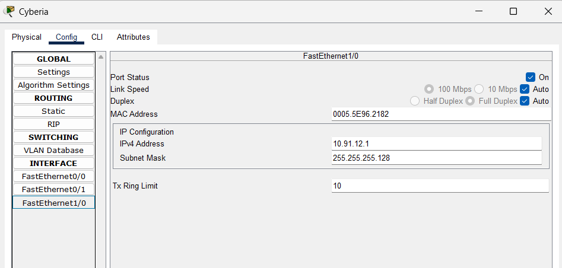
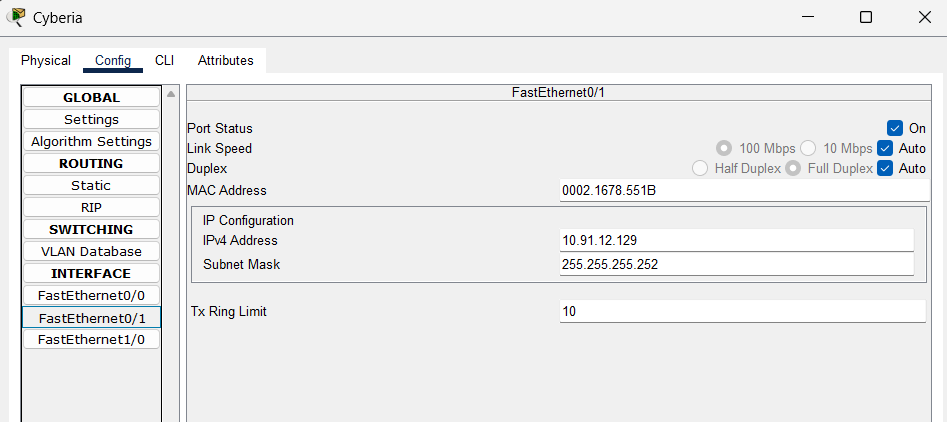

### 7. Static Routing

Pada praktikum ini hanya diharuskan melakukan static routing. Keunggulan CIDR terlihat di sini: karena blok tiap cabang berurutan, satu rute cukup mewakili satu cabang penuh, sehingga tabel routing sangat ringkas. Rute diisi pada menu ROUTING, Static di tab Config tiap router.

Rute statis tiap router:

| Router | Network | Mask | Next Hop | Keterangan |
| ------ | ------- | ---- | -------- | ---------- |
| Cyberia | 10.91.0.0 | 255.255.224.0 | 10.91.12.130 | seluruh jaringan di bawah Wired (/19) |
| Wired | 10.91.12.0 | 255.255.255.0 | 10.91.12.129 | cabang Cyberia (B11) |
| Wired | 10.91.8.0 | 255.255.252.0 | 10.91.10.66 | cabang Navi (C3) |
| Wired | 10.91.0.0 | 255.255.248.0 | 10.91.6.2 | cabang Tachibana sampai Shibuya (F1) |
| Wired | 10.91.20.0 | 255.255.252.0 | 10.91.28.18 | LAN Psyche (A6) |
| Wired | 10.91.16.0 | 255.255.252.0 | 10.91.28.19 | LAN Copland dan Juri (B10) |
| Wired | 10.91.24.0 | 255.255.252.0 | 10.91.28.20 | LAN Accela via Schumann (A11) |
| Wired | 10.91.28.0 | 255.255.255.240 | 10.91.28.20 | Akashi dan link Schumann - Accela (B9) |
| Psyche | 0.0.0.0 | 0.0.0.0 | 10.91.28.17 | default ke Wired |
| Copland | 0.0.0.0 | 0.0.0.0 | 10.91.28.17 | default ke Wired |
| Schumann | 0.0.0.0 | 0.0.0.0 | 10.91.28.17 | default ke Wired |
| Schumann | 10.91.24.0 | 255.255.252.0 | 10.91.28.10 | LAN Accela (A11) |
| Accela | 0.0.0.0 | 0.0.0.0 | 10.91.28.9 | default ke Schumann |
| Navi | 0.0.0.0 | 0.0.0.0 | 10.91.10.65 | default ke Wired |
| Tachibana | 0.0.0.0 | 0.0.0.0 | 10.91.6.1 | default ke Wired |
| Tachibana | 10.91.0.0 | 255.255.252.0 | 10.91.2.130 | cabang Deus sampai Shibuya (E1) |
| Deus | 0.0.0.0 | 0.0.0.0 | 10.91.2.129 | default ke Tachibana |
| Deus | 10.91.0.0 | 255.255.254.0 | 10.91.1.66 | cabang Protocol7 sampai Shibuya (D1) |
| Protocol7 | 0.0.0.0 | 0.0.0.0 | 10.91.1.65 | default ke Deus |
| Protocol7 | 10.91.0.0 | 255.255.255.0 | 10.91.1.138 | cabang Phantoma dan Shibuya (C1) |
| Protocol7 | 10.91.1.128 | 255.255.255.240 | 10.91.1.138 | Eiri dan link Protocol7 - Knights (B3) |
| Knights | 0.0.0.0 | 0.0.0.0 | 10.91.1.137 | default ke Protocol7 |
| Knights | 10.91.0.0 | 255.255.255.0 | 10.91.0.162 | cabang Phantoma dan Shibuya (C1) |
| Phantoma | 0.0.0.0 | 0.0.0.0 | 10.91.0.161 | default ke Knights |
| Phantoma | 10.91.0.0 | 255.255.255.128 | 10.91.0.66 | cabang Shibuya (B1) |
| Shibuya | 0.0.0.0 | 0.0.0.0 | 10.91.0.65 | default ke Phantoma |

Sebagian rute sengaja mencakup subnet yang terhubung langsung ke router itu sendiri (misalnya 10.91.0.0/21 di Wired mencakup link Wired - Tachibana). Hal ini aman karena router selalu memilih rute dengan prefix paling panjang, sehingga subnet yang terhubung langsung tetap dipakai.

Total hanya 25 baris rute untuk 25 subnet di 13 router, jauh lebih sedikit dibandingkan satu rute per subnet di tiap router.

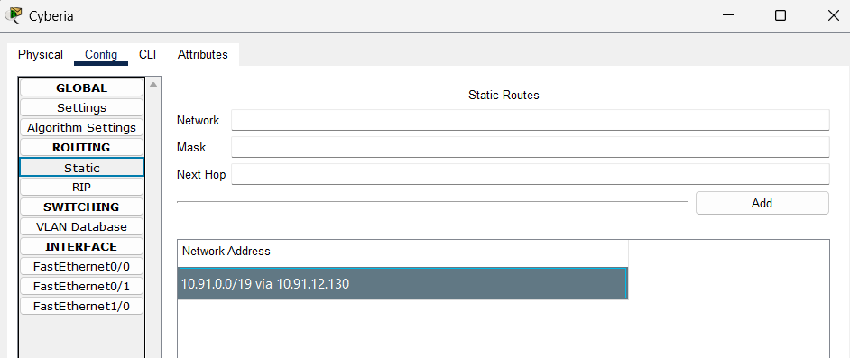
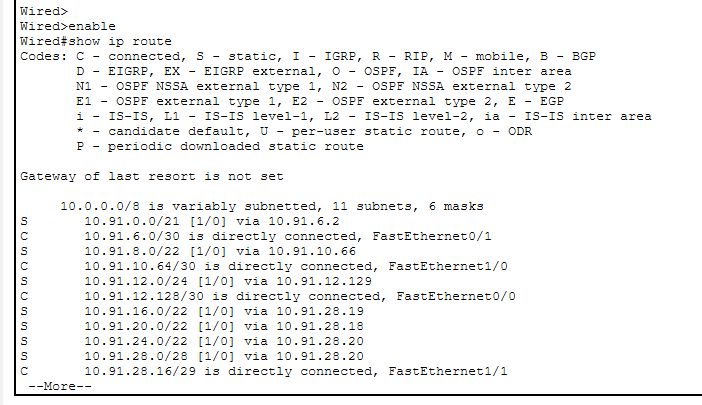

### 8. Konfigurasi IP Client

IP client diisi pada tab Desktop, IP Configuration (Static). Gateway adalah IP interface router yang menghadap client.

| Client | IP Address | Subnet Mask | Default Gateway |
| ------ | ---------- | ----------- | --------------- |
| JJ | 10.91.12.2 | 255.255.255.128 | 10.91.12.1 |
| MyuMyu | 10.91.12.3 | 255.255.255.128 | 10.91.12.1 |
| Karl | 10.91.20.2 | 255.255.252.0 | 10.91.20.1 |
| Lin | 10.91.20.3 | 255.255.252.0 | 10.91.20.1 |
| Masayuki | 10.91.16.2 | 255.255.254.0 | 10.91.16.1 |
| Juri | 10.91.18.2 | 255.255.255.192 | 10.91.18.1 |
| Akashi | 10.91.28.2 | 255.255.255.248 | 10.91.28.1 |
| Omnipresence | 10.91.24.2 | 255.255.252.0 | 10.91.24.1 |
| Denpa | 10.91.24.3 | 255.255.252.0 | 10.91.24.1 |
| Alice | 10.91.8.2 | 255.255.255.0 | 10.91.8.1 |
| Reika | 10.91.8.3 | 255.255.255.0 | 10.91.8.1 |
| Taro | 10.91.10.2 | 255.255.255.192 | 10.91.10.1 |
| Yasuo | 10.91.9.2 | 255.255.255.0 | 10.91.9.1 |
| Miho | 10.91.9.3 | 255.255.255.0 | 10.91.9.1 |
| Kuma | 10.91.9.4 | 255.255.255.0 | 10.91.9.1 |
| Collective | 10.91.4.2 | 255.255.254.0 | 10.91.4.1 |
| Ghost | 10.91.4.3 | 255.255.254.0 | 10.91.4.1 |
| Lilith | 10.91.2.2 | 255.255.255.128 | 10.91.2.1 |
| Specter | 10.91.2.3 | 255.255.255.128 | 10.91.2.1 |
| Chisa | 10.91.1.2 | 255.255.255.192 | 10.91.1.1 |
| Hodgeson | 10.91.1.3 | 255.255.255.192 | 10.91.1.1 |
| Eiri | 10.91.1.130 | 255.255.255.248 | 10.91.1.129 |
| Semi | 10.91.0.130 | 255.255.255.224 | 10.91.0.129 |
| Lain | 10.91.0.2 | 255.255.255.192 | 10.91.0.1 |
| Mika | 10.91.0.3 | 255.255.255.192 | 10.91.0.1 |

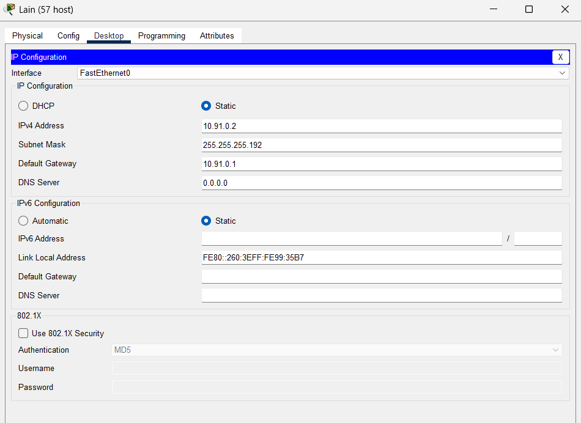

### 9. Testing Koneksi (Ping)

Validasi dilakukan dengan ping antar client dari cabang yang berbeda, dimulai dari pasangan terjauh.

| Dari | Tujuan | Alamat tujuan | Hasil |
| ---- | ------ | ------------- | ----- |
| Lain | Karl | 10.91.20.2 | BERHASIL |
| JJ | Mika | 10.91.0.3 | BERHASIL |
| Omnipresence | Chisa | 10.91.1.2 | BERHASIL |
| Alice | Denpa | 10.91.24.3 | BERHASIL |
| Juri | Eiri | 10.91.1.130 | BERHASIL |
| Akashi | Collective | 10.91.4.2 | BERHASIL |

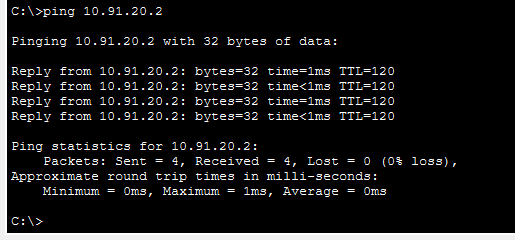
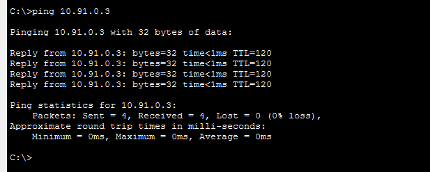
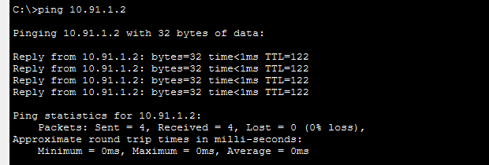
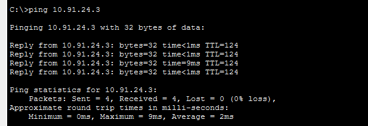
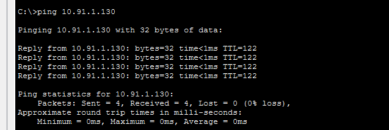
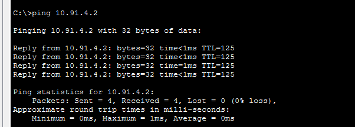

---

